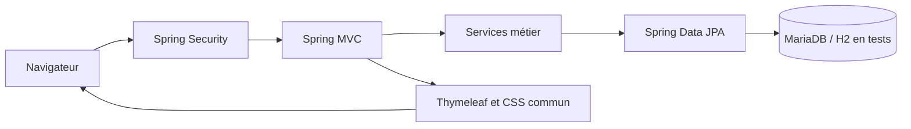
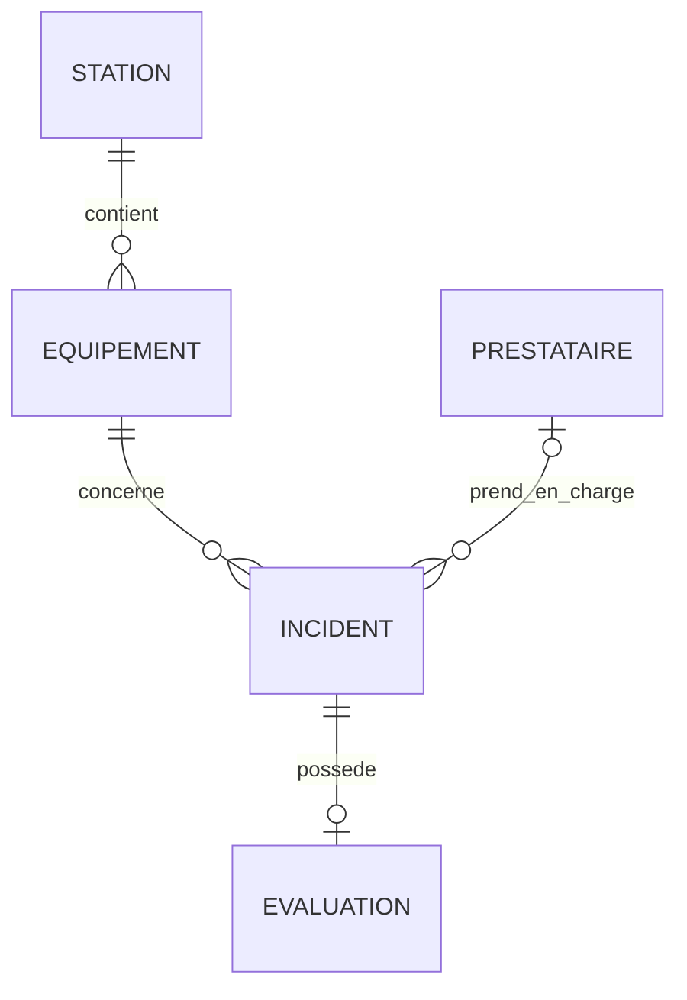

# Journal — Guardian (ALTN72, 2026-27)

**Groupe :** Adem BRAHMI, Kais DILMI

**Mise à jour :** 5 novembre 2026

**Date limite Moodle :** 5 novembre 2026 à 23 h 59.

Ce journal décrit l'état actuel du dépôt et distingue les réalisations des travaux restants.

## README

Guardian permet de consulter les équipements des stations, de déclarer une panne et de consulter les incidents.

### Prérequis

- **Java :** JDK 25 pour le compilateur Maven actuel. Le POM indique encore `java.version=21`, mais configure `source=25` et `target=25` ; harmonisation restante.
- **Maven :** validation réalisée avec Maven 3.9.11.
- **Base :** MariaDB en fonctionnement normal ; H2 en mémoire pour les tests.
- **Framework :** Spring Boot 4.1.1.

### Configuration

| Variable            | Rôle                                              | Valeur                                                    |
| ------------------- | ------------------------------------------------- | --------------------------------------------------------- |
| `DB_URL`            | Connexion MariaDB                                 | Par défaut : `jdbc:mariadb://localhost:3307/guardian_bdd` |
| `DB_USER`           | Utilisateur MariaDB                               | Par défaut : `root` ; adapter au poste                    |
| `DB_PASSWORD`       | Mot de passe MariaDB                              | À définir localement ; défaut vide                        |
| `DEMO_MOT_DE_PASSE` | Mot de passe initial des comptes de démonstration | Obligatoire au démarrage, choisi localement               |

Exemple PowerShell, après remplacement des valeurs locales :

```powershell
$env:DB_URL = "jdbc:mariadb://localhost:3307/guardian_bdd"
$env:DB_USER = "<utilisateur MariaDB>"
$env:DB_PASSWORD = "<mot de passe MariaDB>"
$env:DEMO_MOT_DE_PASSE = "<mot de passe de démonstration>"
mvn spring-boot:run
```

### Initialisation et lancement

1. Démarrer MariaDB.
2. Exécuter manuellement `src/main/resources/schema.sql` avec un client MariaDB.
3. Définir les variables ci-dessus.
4. Lancer `mvn spring-boot:run`.
5. Ouvrir [la connexion locale](http://localhost:8080/connexion).

Le script supprime et recrée les tables du domaine et les utilisateurs : il prépare une base de démonstration, sans préserver les données existantes. L'ordre de création de `station` a été corrigé : après `USE guardian_bdd` et après les suppressions. Son exécution sur MariaDB vierge reste à vérifier.

`InitialisationUtilisateursDemo` crée les comptes absents au démarrage avec BCrypt :

| Profil                     | Login         | Prénom  | Mot de passe initial                 |
| -------------------------- | ------------- | ------- | ------------------------------------ |
| Responsable d'exploitation | `responsable` | Camille | Valeur locale de `DEMO_MOT_DE_PASSE` |
| Agent de signalement       | `agent`       | Alex    | Valeur locale de `DEMO_MOT_DE_PASSE` |

Changer cette variable ne change pas le mot de passe des comptes déjà créés. Aucun secret local n'est reproduit dans ce journal.

**Comptes de test de la version en ligne** (https://guardian-efrei.up.railway.app) : `responsable` / `VotreMotDePasseDeDemo` et `agent` / `VotreMotDePasseDeDemo`.

- **Tests :** `mvn verify`, sans serveur MariaDB nécessaire.
- **Application déployée :** https://guardian-efrei.up.railway.app (comptes de test ci-dessus).
- **Hébergement :** Railway, un service pour l'application (construite depuis la branche `develop`) et un service MySQL 8.4 dans le même projet, reliés par le réseau privé de Railway. La base a été initialisée avec `schema.sql`. Variables définies sur Railway : `DB_URL` (avec `allowPublicKeyRetrieval=true`, requis par MySQL 8 avec le driver MariaDB), `DB_USER`, `DB_PASSWORD`, `DEMO_MOT_DE_PASSE` et `TZ=Europe/Paris` (pour que l'indicateur 48 h / 72 h soit calculé à la même heure que les dates de la base). Le port est lu dans la variable `PORT` imposée par Railway (`server.port=${PORT:8080}`).
- **API incidents et Swagger / OpenAPI :** non implémentés (F12).
- **Démonstration SQL :** deux stations, trois équipements (distributeur, portique, borne), deux prestataires, deux incidents dont un résolu, et une évaluation.
- **Dates :** les incidents historiques restent datés de juin 2026 ; les incidents actifs du tableau de bord sont générés relativement à l'exécution du script (`NOW() - INTERVAL 47/48/72 HOUR`) pour couvrir les seuils de RG3.
- **Limites :** le lot alpha comprend l'import CSV / export PDF et la page Statistiques, tous deux réservés au responsable. F6 permet de corriger la description et, sous conditions, l'équipement ; F8 permet au responsable de clôturer un incident ; F9 présente les incidents résolus aux deux profils ; F7 permet au responsable d'affecter puis de réaffecter un prestataire à un incident non résolu. F10 permet au responsable d'évaluer le prestataire d'un incident résolu ; la note est consultable dans le détail de l'incident (F5).
- **Héritage du TP :** les pages programmeurs sont conservées et restylées ; leur table n'est pas créée par le script Guardian. Leur fonctionnement sur une base initialisée uniquement avec ce script n'a pas été validé.

## ARCHITECTURE

**Dépôt :** [ALTN72_2026-27_Projet_Java_FullStack](https://github.com/adembrahmi13/ALTN72_2026-27_Projet_Java_FullStack).



### Organisation en couches

Packages relatifs à `altn72.tpfilrouge`.

| Couche          | Emplacement                                            | Responsabilité                                                    |
| --------------- | ------------------------------------------------------ | ----------------------------------------------------------------- |
| Contrôleurs web | `controleur`                                           | Routes, formulaires, modèles de vues et redirections              |
| Services        | `service`                                              | Déclaration, recherche des ressources, détail et durée d'incident |
| Repositories    | `repository` ; interfaces héritées aussi dans `modele` | Accès aux données JPA                                             |
| Modèle          | `modele`                                               | Entités et enum Profil                                            |
| Exceptions      | `exception`                                            | Ressource introuvable et gestion centralisée des 404              |
| Sécurité        | `configuration` et services utilisateur                | Authentification, BCrypt, comptes de démonstration                |
| Présentation    | `templates` et `static/css/style.css`                  | Vues HTML, fragment d'en-tête et styles communs                   |

### Modèle de données



`Utilisateur` porte le profil `RESPONSABLE_EXPLOITATION` ou `AGENT_SIGNALEMENT`.
`Programmeur` est hérité du TP, hors domaine Guardian.
`DetailIncident` est un record de présentation, non persisté.

### Technologies

Java 25, Maven, Spring Boot 4.1.1, Spring MVC, Spring Data JPA / Hibernate,
Spring Security, Thymeleaf et son intégration Spring Security, Jakarta Validation,
pilote MariaDB, H2, JUnit Jupiter et MockMvc. Les versions des dépendances sont
gérées par le parent Spring Boot. Apache Commons CSV 1.14.1 et Apache PDFBox 3.0.8
sont ajoutés pour l'import et l'export ; aucune bibliothèque graphique n'est
encore ajoutée. L'interface utilise du CSS local et des polices système.

## TESTS

- **Stratégie :** intégration Spring Boot avec MockMvc, services et repositories réels, base H2 en mémoire en mode MariaDB. Aucun service métier mocké.
- **Configuration :** `src/test/resources/application.properties`, schéma JPA `create-drop`, script MariaDB désactivé.
- **Isolation :** transactions et retour arrière pour les tests de données.
- **Commande :** `mvn verify`.
- **Dernière validation après refonte front :** `mvn verify` réussi, 99 tests sans échec ni erreur.
- **Horloge :** `Clock` injectable ; horloge fixe UTC pour les durées F5.
- **Couverture chiffrée :** non mesurée, aucun rapport JaCoCo configuré.

### Comportements couverts

| Fonctionnalité           | Scénarios                                                                                                                                                                                                                                                                     | Classe                                                  | Nombre |
| ------------------------ | ----------------------------------------------------------------------------------------------------------------------------------------------------------------------------------------------------------------------------------------------------------------------------- | ------------------------------------------------------- | ------ |
| F1                       | Connexion publique, visiteur redirigé, identifiants invalides refusés                                                                                                                                                                                                         | `ConnexionTest`, dans `TpFilRougeApplicationTests.java` | 3      |
| F2                       | Stations affichées et station absente en 404                                                                                                                                                                                                                                  | `EquipementsParStationTest`                             | 2      |
| F3                       | Incidents triés par ouverture décroissante et équipement absent en 404                                                                                                                                                                                                        | `FicheEquipementTest`                                   | 2      |
| F4                       | Création avec valeurs imposées, description vide refusée, équipement absent en 404                                                                                                                                                                                            | `DeclarationIncidentTest`                               | 3      |
| F5                       | Agent sans prestataire/évaluation, responsable avec prestataire/évaluation et durée arrêtée, affectation sans évaluation, incident absent en 404, visiteur redirigé, lien depuis l'équipement                                                                                 | `DetailIncidentTest`                                    | 6      |
| F6                       | Formulaires selon profil, correction de description, changement d'équipement réservé au responsable avant affectation, refus sans modification partielle, champs sensibles ignorés, validation, 404, incident résolu en 409, visiteur et CSRF, rôle inconnu refusé au service | `ModificationIncidentTest`                              | 13     |
| F8                       | Résolution avec/sans prestataire, date serveur, égalité avec ouverture, ouverture future refusée, double clôture refusée, statut déjà résolu sans date, agent refusé par URL et service, 404, visiteur, CSRF                                                                  | `ResolutionIncidentTest`                                | 10     |
| F7                       | Affectation puis réaffectation, incident résolu refusé (409), agent refusé par URL et formulaire masqué, incident ou prestataire inexistant en 404                                                                                                                            | `AffectationPrestataireTest`                            | 4      |
| F10                      | Évaluation enregistrée avec date serveur, incident non résolu ou sans prestataire refusé (409), une seule évaluation par incident, note 0/6/vide refusée par le formulaire, agent refusé par URL et lien masqué, 404                                                          | `EvaluationPrestataireTest`                             | 7      |
| F11                      | 47 h et 47 h 59 vert, 48 h et 71 h 59 orange, 72 h rouge, affecté distinct même très ancien, résolu absent, filtres station + niveau, agent refusé (403) et lien masqué, niveau invalide dans l'URL (400), comptage par station (requête native)                              | `TableauDeBordTest`                                     | 9      |
| Statistiques (lot alpha) | Note moyenne par prestataire, incidents par type d'équipement, type sans incident absent, page avec les deux graphiques, agent refusé (403) et lien masqué                                                                                                                    | `StatistiquesTest`                                      | 4      |
| F9                       | Tri par résolution et exclusion des incidents ouverts/incohérents, consultation agent avec prestataire, état vide, visiteur redirigé, intégration F8, ordre stable à date égale                                                                                               | `HistoriqueIncidentsTest`                               | 6      |
| Import CSV               | Accents/BOM, guillemets, séparateurs et retours à la ligne, doublons, stations inconnues/ambiguës, données invalides, limites, modèles, droits et CSRF                                                                                                                        | `ImportDonneesTest`                                     | 11     |
| Export PDF               | PDF lisible, ordre et exclusion des incidents ouverts, fichier vide, pagination et longs textes, permissions et visiteur                                                                                                                                                      | `ExportHistoriquePdfTest`                               | 5      |

F4 vérifie qu'un statut et un prestataire envoyés dans un formulaire manipulé
ne remplacent pas les valeurs imposées par le service. F5 vérifie le HTML rendu
et les durées exactes en jours, heures et minutes.

### Comportements non couverts

| Comportement                                                         | Situation                                                                                           |
| -------------------------------------------------------------------- | --------------------------------------------------------------------------------------------------- |
| Connexion réussie et déconnexion complète                            | Tests dédiés à ajouter                                                                              |
| Indicateurs 47 h / 48 h / 72 h et état affecté (RG3–RG4)             | Calcul dans `TableauDeBordService` avec horloge injectée, seuils testés à la minute près            |
| Affectation, réaffectation et exclusion du tableau de bord (RG5–RG6) | F7, F8 et F11 réalisées et testées                                                                  |
| Refus d'évaluation avant résolution, doublons, notes invalides (RG8) | Règles RG8 appliquées dans `EvaluationService` et testées                                           |
| Référence d'équipement unique (RG9)                                  | Contrainte présente, test de violation absent                                                       |
| Restrictions par profil (RG11)                                       | Restrictions F6, F7, F8, F10 et F11 testées                                                         |
| API incidents et agrégations graphiques                              | Fonctionnalités absentes                                                                            |
| Import/export sur MariaDB et limites HTTP multipart réelles          | Tests MockMvc/H2 ; limites du service testées, dépassement HTTP traité mais sans test serveur dédié |
| Script SQL MariaDB                                                   | Tests sur H2 uniquement                                                                             |
| Navigateurs autres que Chromium et accessibilité exhaustive | Contrôle Chromium desktop/mobile effectué ; Safari/Firefox et audit complet restants |

## CHOIX TECHNIQUES

### Droits par profil

> Tableau du §5.6 : indiquer pour chaque fonctionnalité **Complet**, **Lecture seule** ou **Interdit**.
> Toute restriction est appliquée **côté serveur** (RG11) : masquer un bouton ne suffit pas.

| N°    | Fonctionnalité                        | Profil 1 : Responsable d'exploitation | Profil 2 : Agent |
| ----- | ------------------------------------- | ------------------------------------- | ---------------- |
| F2–F3 | Consulter équipements et fiches       | ✅                                    | ✅               |
| F4    | Déclarer un incident                  | ✅                                    | ✅               |
| F5–F6 | Consulter / modifier un incident      | ✅                                    | ✅               |
| F7    | Affecter ou réaffecter un prestataire | ✅                                    | ❌               |
| F8    | Déclarer un incident résolu           | ✅                                    | ❌               |
| F9    | Consulter l'historique                | ✅                                    | ✅               |
| F10   | Évaluer un prestataire                | ✅                                    | ❌               |
| F11   | Tableau de bord                       | ✅                                    | ❌               |

Ce tableau présente la répartition des droits retenue. Les fonctionnalités encore
absentes et les restrictions restant à implémenter sont indiquées dans le suivi interne.

Les deux profils consultent et signalent les pannes. La cible réserve au
responsable la coordination des prestataires, la clôture et l'évaluation.
Pour F6, les deux profils peuvent corriger la description ; seul le responsable
peut corriger l'équipement avant toute affectation. Les règles détaillées ci-dessous
préservent l'historique et la cohérence de la prise en charge.

`SecurityConfig` laisse publiques la connexion et les ressources CSS/images puis
exige une authentification pour toute autre requête. `UtilisateurConnecte`
fournit les rôles. `@EnableMethodSecurity` active `@PreAuthorize` sur les méthodes
de préparation et d'enregistrement F6 : seuls les deux profils métier y accèdent.
`DroitsIncident` contrôle les champs autorisés à partir du contexte de sécurité,
sans accepter de profil transmis par le formulaire. Ces règles sont utilisées par
le service et l'interface. F7, F8, F10 et F11 sont également protégées au service.

### Modification des informations autorisées — F6

Depuis le détail d'un incident ouvert, le bouton « Modifier l'incident » ouvre
`GET /incidents/{id}/modifier`. Le formulaire prérempli envoie un POST vers la
même URL ; après succès, une redirection vers le détail affiche une confirmation.
L'action Annuler revient au détail sans enregistrer.

| Information                                 | Responsable d'exploitation | Agent de signalement   | Justification                                                              |
| ------------------------------------------- | -------------------------- | ---------------------- | -------------------------------------------------------------------------- |
| Description d'un incident ouvert            | Modifiable                 | Modifiable             | Corriger ou préciser le signalement, même après affectation                |
| Équipement d'un incident non affecté        | Modifiable                 | Lecture seule          | Le responsable peut corriger une erreur de rattachement avant intervention |
| Équipement après affectation                | Lecture seule              | Lecture seule          | Ne pas déplacer une intervention déjà engagée                              |
| Station                                     | Déduite de l'équipement    | Lecture seule          | Éviter un incident associé à une station incompatible avec l'équipement    |
| Identifiant et date d'ouverture             | Lecture seule              | Lecture seule          | Préserver l'identité et le calcul des délais                               |
| Statut, prestataire, résolution, évaluation | Non modifiables via F6     | Non modifiables via F6 | Opérations distinctes F7, F8 et F10, réservées au responsable              |
| Incident résolu                             | Lecture seule              | Lecture seule          | Préserver l'historique et les évaluations après clôture                    |

Le responsable dispose de tous les droits métier prévus au tableau, mais reste
soumis aux règles de cohérence : F6 ne permet pas de réécrire un incident clôturé.
Les opérations F7, F8 et F10 restent distinctes de ce formulaire.
Le modèle actuel ne mémorise pas l'auteur du signalement : les droits sont donc
définis par profil et état, sans restriction « uniquement ses propres incidents ».

La description est obligatoire, limitée à 255 caractères (mapping JPA actuel) et
nettoyée des espaces en début et fin. Le formulaire dédié `ModificationIncident`
et une liste de champs autorisés au binding ne prennent que `description` et
`equipementId`. Le service recharge l'incident avant l'enregistrement, vérifie son
état et compare l'équipement demandé à l'équipement actuel. Envoyer un autre rôle,
statut, identifiant ou une date dans la requête ne donne aucun droit supplémentaire.

`IncidentService.modifierIncident` est transactionnel : la description et le
rattachement sont enregistrés ensemble après validation. Un changement d'équipement
interdit renvoie 403 ; une tentative sur un incident résolu renvoie 409 ; une
ressource absente renvoie 404. Les tests contrôlent aussi l'absence de modifications
partielles après refus. Les formulaires conservent la protection CSRF.

### Résolution d'un incident — F8

Le responsable dispose du bouton « Déclarer l'incident comme résolu » sur le détail
d'un incident ouvert. Un texte précise que la clôture rend le signalement non
modifiable. Le formulaire POST vers `/incidents/{id}/resoudre` utilise le jeton
CSRF Thymeleaf. Après succès, le détail affiche un message de confirmation, le statut
« Résolu » et la date/heure ; les actions modifier et résoudre disparaissent.

`IncidentService.resoudreIncident` est protégé par
`@PreAuthorize("hasRole('RESPONSABLE_EXPLOITATION')")` : une requête directe ou un
appel du service par l'agent est refusé en 403. L'heure provient exclusivement de
`LocalDateTime.now(horloge)` ; aucun champ envoyé par le client ne peut la remplacer.
Le statut et la date sont enregistrés dans une même transaction.

La résolution est autorisée avec ou sans prestataire : le sujet ne rend pas
l'affectation obligatoire avant clôture. Le prestataire éventuel est conservé.
La date doit être postérieure ou égale à l'ouverture (RG5) ; une ouverture située
dans le futur provoque un refus 409 sans modification. Une seconde clôture est
également refusée en 409 pour conserver la première date.

`IncidentRepository.trouverPourResolution` utilise une requête JPQL paramétrée et
un verrou `PESSIMISTIC_WRITE` pendant la transaction pour sérialiser les clôtures
concurrentes. Le scénario de concurrence n'est pas testé automatiquement.
La constante `Incident.STATUT_RESOLU` est partagée avec le contrôle des droits F6.
La durée F5 s'arrête à la résolution et la fiche équipement affiche la clôture.
F7 interdit également toute affectation ou réaffectation d'un incident résolu (`AffectationIncidentInterditeException`, 409).

### Historique des incidents résolus — F9

Le lien « Historique des incidents » dans l'en-tête commun ouvre
`GET /incidents/historique`. Les deux profils disposent d'un accès en lecture,
conformément au tableau des droits. `IncidentService.consulterHistorique` est
protégé par `@PreAuthorize` pour le responsable et l'agent et utilise une
transaction en lecture seule.

La requête dérivée sélectionne le statut « Résolu » avec une date de résolution
non nulle. Elle trie par résolution décroissante (RG7), et non par ouverture ;
l'identifiant décroissant départage les dates égales pour garantir un ordre stable.
Les lignes incohérentes (statut résolu sans date ou date sans statut résolu)
ne sont pas affichées. Un `@EntityGraph` charge l'équipement, la station et le
prestataire pour éviter une requête supplémentaire par ligne lors du rendu.

`historiqueIncidents.html` reprend la feuille CSS commune et le tableau défilant
sur mobile. Il présente résolution, description et numéro d'incident, équipement,
station, ouverture et prestataire éventuel. Les liens donnent accès au détail F5
et à la fiche équipement. L'absence d'incidents est signalée par un message.
Un incident clôturé par F8 apparaît à la consultation suivante ; aucune copie
des données ou table d'archive supplémentaire n'est nécessaire.

L'historique ne propose pas d'opération de modification. La pagination et les
filtres ne sont pas implémentés dans cette version.

### Déclaration F4 et détail F5

**F4 :** description obligatoire avec `@NotBlank`. Le service utilise l'équipement
de l'URL, la description saisie et l'horloge ; il impose le statut « Non affecté »,
sans prestataire ni résolution.

**F5 :** le lien sur la description dans `ficheEquipement.html` ouvre
`GET /incidents/{id}`. `IncidentController` appelle
`IncidentService.consulterDetail` et rend `detailIncident.html`.

La page affiche description, équipement, station, statut, dates et durée,
nom et contact du prestataire éventuel, note, commentaire éventuel et date
de l'évaluation. Des messages indiquent explicitement les absences.

La durée est calculée dans le service avec `Clock`, sans stockage en base :

- ouvert : instant courant moins ouverture ;
- résolu : résolution moins ouverture.

L'affichage en jours, heures et minutes reste actualisé à chaque consultation
et ne continue pas à augmenter après résolution.
`HorlogeConfig` fournit l'horloge réelle ; les tests utilisent une horloge fixe.

`Prestataire` et `Evaluation` ont été ajoutés au modèle Java.
`Incident.prestataireId` conserve l'écriture compatible avec F4 et une relation
`@ManyToOne` en lecture seule (`insertable=false, updatable=false`)
permet de consulter le prestataire. `EvaluationRepository.findByIncident_Id`
retrouve l'évaluation. L'unicité de `evaluation.incident_id` est définie dans JPA
et SQL. `EvaluationService` vérifie RG8 avant l'enregistrement (incident résolu, prestataire affecté, pas d'évaluation existante, note de 1 à 5).

### Exceptions

- **Guardian :** `RessourceIntrouvableException`, gérée par `GestionnaireExceptionsWeb` avec `@ControllerAdvice`.
- **Justification :** recherche dans les services et réponse 404 centralisée, sans répéter le traitement dans chaque contrôleur.
- **Message :** « Incident introuvable (identifiant …). », même principe pour station et équipement.
- **Validation F4 :** `@Valid` et `BindingResult` réaffichent le formulaire avec un message français ; aucune exception personnalisée 400 pour ce cas.
- **Modification F6 / 409 :** `ModificationIncidentInterditeException` empêche la modification d'un incident résolu.
- **Résolution F8 / 409 :** `ResolutionIncidentInterditeException` refuse une double clôture ou une date antérieure à l'ouverture.
- **Droits F6 / 403 :** `AccessDeniedException` est traitée par le gestionnaire web avec un message français.
- **Pages :** `erreur.html` affiche le message et propose un retour à l'accueil.
- **`ResponseEntity` :** utilisé pour les téléchargements des modèles CSV et de l'historique PDF, avec type MIME et en-tête `Content-Disposition`. Les routes de consultation retournent des vues ou redirections.
- **Import :** `ImportCsvException` donne un message métier sans insertion partielle ; dépassement multipart traité en 413 avec une page d'erreur française.

### Principes SOLID

| Principe                       | Application ou justification                                                                                        |
| ------------------------------ | ------------------------------------------------------------------------------------------------------------------- |
| S — Responsabilité unique      | Contrôleurs pour requêtes/vues, services pour règles et durée, repositories pour persistance, CSS pour présentation |
| O — Ouvert / fermé             | Aucun mécanisme d'extension dédié revendiqué ; pas de hiérarchie ajoutée sans besoin concret                        |
| L — Substitution de Liskov     | Pas de hiérarchie métier personnalisée à démontrer                                                                  |
| I — Ségrégation des interfaces | Repositories séparés par entité ; pas d'interface métier générale imposant des méthodes inutiles                    |
| D — Inversion des dépendances  | Injection par constructeur des interfaces Spring Data et de `Clock`, remplaçable en test                            |

### Persistance

| Requête dérivée                                                                                      | Besoin                                                                                                 |
| ---------------------------------------------------------------------------------------------------- | ------------------------------------------------------------------------------------------------------ |
| `StationRepository.findAllByOrderByNomAsc`                                                           | Stations triées par nom                                                                                |
| `EquipementRepository.findByStation_Id`                                                              | Équipements d'une station                                                                              |
| `IncidentRepository.findByEquipement_IdOrderByDateHeureOuvertureDesc`                                | Incidents d'un équipement, récents en premier                                                          |
| `IncidentRepository.findByStatutAndDateHeureResolutionIsNotNullOrderByDateHeureResolutionDescIdDesc` | Historique F9 : statut résolu, date de clôture présente, tri par clôture puis identifiant décroissants |
| `EvaluationRepository.findByIncident_Id`                                                             | Évaluation éventuelle                                                                                  |
| `EvaluationRepository.existsByIncident_Id`                                                           | F10 : refuser une seconde évaluation (RG8)                                                             |
| `IncidentRepository.findByDateHeureResolutionIsNullOrderByDateHeureOuvertureAscIdAsc`                | F11 : incidents actifs, du plus ancien au plus récent (RG6)                                            |
| `UtilisateurRepository.findByLogin`                                                                  | Utilisateur pour authentification                                                                      |

**JPQL explicite :** `IncidentRepository.trouverPourResolution` sélectionne l'incident
par identifiant avec `@Query` et un verrou d'écriture pour protéger la clôture.
`EvaluationRepository.calculerNoteMoyenneParPrestataire` et `IncidentRepository.compterIncidentsParType`
agrègent en JPQL (`avg`, `count`, `group by`) pour la page Statistiques du lot alpha.
**Requête SQL native (unique) :** `IncidentRepository.compterIncidentsActifsParStation`,
utilisée par l'indicateur « incidents actifs par station » du tableau de bord F11.
Elle joint `incident`, `equipement` et `station`, garde les incidents sans date de
résolution (RG6), puis compte par station avec `GROUP BY`. Le résultat est lu via
l'interface de projection `IncidentsActifsParStation` (alias `nom` et `nombre`).

_Analyse critique :_

- **Ce qu'on y gagne :** la base fait l'agrégation et ne renvoie qu'une ligne par
  station, au lieu de charger tous les incidents en mémoire pour les compter en Java.
  Le SQL est lisible tel quel et peut être testé directement dans un client MariaDB.
- **Ce qu'on y perd :** la requête porte sur les noms de **tables et colonnes**
  (`date_heure_resolution`, `station_id`) et non sur les entités. Renommer un attribut
  ou une colonne ne provoque aucune erreur de compilation : l'erreur n'apparaît qu'à
  l'exécution. Aucune vérification au démarrage, contrairement au JPQL.
- **Portabilité :** seul du SQL standard est utilisé (`JOIN`, `COUNT`, `GROUP BY`) ;
  la requête fonctionne sur MariaDB et sur H2 (tests). Une syntaxe propre à MariaDB
  l'aurait rendue intestable avec H2.
- **Sécurité :** aucun paramètre n'est concaténé (la requête n'en a pas) ; un paramètre
  futur devrait être lié (`:parametre`) pour éviter l'injection SQL.
- **Conclusion :** ici, JPQL aurait suffi (`select new ...` avec `group by`). Le natif
  est acceptable pour une agrégation simple et isolée, mais nous le limitons à cette
  seule requête : pour le reste, les requêtes dérivées et JPQL restent plus sûres.

**Script :** `src/main/resources/schema.sql`, ordre de création de station corrigé
et unicité de l'évaluation ajoutée. Les tests H2 génèrent le schéma depuis les
entités ; ils ne valident pas l'exécution du script MariaDB.

### Transactions

| Où                                                                      | Pourquoi                                                                                    |
| ----------------------------------------------------------------------- | ------------------------------------------------------------------------------------------- |
| `IncidentService.consulterDetail`, `@Transactional(readOnly = true)`    | Regrouper les lectures du détail et de l'évaluation sans modification métier                |
| `IncidentService.preparerModification`, lecture seule                   | Charger et vérifier l'incident pour le formulaire F6                                        |
| `IncidentService.modifierIncident`, `@Transactional`                    | Vérifier les droits et enregistrer description/rattachement ensemble par dirty checking JPA |
| `IncidentService.resoudreIncident`, `@Transactional`                    | Vérifier et verrouiller l'incident, enregistrer statut et date ensemble (RG5 et RG10)       |
| `IncidentService.consulterHistorique`, lecture seule                    | Lire les incidents résolus et leurs relations pour F9                                       |
| `ImportCsvService.importer`, `@Transactional`                           | Valider tout le fichier, puis insérer et flusher le lot ; rollback en cas d'erreur (RG10)   |
| Repositories Spring Data                                                | Transactions standard, dont l'insertion F4                                                  |
| `ProgrammeurService.supprimerProgrammeur` et `modifierProgrammeur` (TP) | Vérification/suppression et lecture/modification dans une transaction                       |
| Tests de données                                                        | Retour arrière après chaque test                                                            |

Les futures opérations modifiant plusieurs données devront être regroupées
dans une transaction de service pour respecter RG10.

### Sécurité

- Hachage par `BCryptPasswordEncoder` de Spring Security.
- Configuration et secrets locaux via variables d'environnement.
- Connexion avec redirection vers l'accueil, message d'échec, session authentifiée.
- Déconnexion par POST `/deconnexion`, invalidation de session et suppression de `JSESSIONID`.
- Protection CSRF conservée ; formulaires Thymeleaf et jetons CSRF dans les tests POST.
- En-tête commun avec prénom, profil et déconnexion.
- F6 : sécurité de méthode, permissions par champ et par état dans le service ; masquer un contrôle dans la vue ne remplace pas la vérification serveur.
- API incidents absente ; sécurité et erreurs à valider lors de F12.

### Interface et CSS commun

Refonte du front le 5 novembre : toutes les pages partagent `static/css/style.css`
et le fragment `fragments/entete.html`, sans framework front supplémentaire.

- Identité visuelle : navigation bleu profond `#142c35`, vert `#137766`, accent menthe et surfaces blanches sur fond gris clair.
- Navigation latérale persistante sur ordinateur, page active indiquée, en-tête avec identité et déconnexion regroupées.
- Menu mobile sous 1 000 px : bouton avec état `aria-expanded`, voile de fermeture, Échap, déplacement et maintien du focus clavier dans les liens du menu.
- Accueil avec raccourcis adaptés au profil et illustration de réseau en SVG ; aucune statistique fictive affichée.
- Connexion en deux panneaux sur ordinateur et formulaire compact sur mobile, champs avec autocomplétion et messages conservés.
- Tableau de bord : compteurs en cartes, filtres alignés, niveaux d'attention identifiés par texte et couleur.
- Stations en cartes avec accès explicite aux équipements ; fiches avec statuts visuels et lien « Voir le détail » pour chaque incident.
- Affectation mise en évidence dans un panneau ; action de résolution placée après les informations pour encourager leur consultation avant clôture.
- Statistiques organisées en panneaux, boutons, formulaires et messages cohérents sur toutes les pages.
- Recherche locale dans les tableaux via `static/js/interface.js` : plusieurs mots, insensible à la casse et aux accents, compteur de résultats et état vide. Elle porte sur les lignes déjà affichées après les éventuels filtres serveur.
- Tableaux défilants sur mobile, lien d'évitement vers le contenu, focus visible, icônes décoratives masquées aux lecteurs d'écran, respect de `prefers-reduced-motion` et styles d'impression.
- Polices système, SVG et scripts locaux : aucun CDN requis pour cette interface.

Les règles métier, routes, champs de formulaires et contrôles serveur des profils
sont conservés. Les fonctionnalités sans JavaScript restent disponibles ; le menu
mobile et la recherche dans les tableaux nécessitent JavaScript.

La couleur d'erreur ne représente pas une urgence d'incident.
Les seuils 48 h / 72 h sont les constantes `SEUIL_ORANGE_HEURES` et `SEUIL_ROUGE_HEURES` de `TableauDeBordService`, seul endroit où elles sont définies. Le niveau d'attention (`NiveauAttention`) est recalculé à chaque affichage avec l'heure courante, jamais enregistré en base.
Validation : 99 tests Maven réussis. Contrôle Chromium via Playwright sur une base
H2 de démonstration isolée : 10 pages sur ordinateur (1 440 px), 6 pages sur mobile
(390 px), connexion/déconnexion et accueil agent, menu mobile/Échap et recherche
sans accents. Captures et script de contrôle local dans `target/ui-captures` et
`target/ui-verification.cjs` (non versionnés). Aucun débordement horizontal global
ni erreur JavaScript détecté sur ces parcours. Vérification Safari/Firefox et
validation exhaustive d'accessibilité restantes.

## LOT ALPHA

### Import / export de données — piste 9

- **Besoin :** charger un inventaire préparé dans un tableur sans saisir les stations et équipements un par un, puis partager l'historique sous forme de document lisible.
- **État :** import de stations et équipements en CSV, export de l'historique F9 en PDF implémentés.
- **Indépendance :** aucune dépendance à F10 ou F11 ; les évaluations ne sont pas incluses dans le PDF.
- **Droits :** responsable uniquement pour import, modèles et export PDF. L'agent conserve la lecture F9. Contrôles `@PreAuthorize` sur le contrôleur et les services, boutons réservés au responsable, CSRF sur l'import.
- **Bibliothèques :** [Apache Commons CSV](https://commons.apache.org/proper/commons-csv/) 1.14.1 et [Apache PDFBox](https://pdfbox.apache.org/) 3.0.8.

#### Utilisation et format CSV

1. Se connecter comme responsable et ouvrir « Importer des données » dans le menu.
2. Télécharger le modèle stations, remplacer les exemples, puis importer les stations.
3. Télécharger le modèle équipements et renseigner les noms de stations déjà présents.
4. Enregistrer en CSV UTF-8, séparateur point-virgule ; conserver l'ordre exact des en-têtes.
5. Sélectionner le type et le fichier, puis importer. Une confirmation indique le nombre ajouté.

En-tête stations : `nom` (obligatoire, 100 caractères maximum).

En-tête équipements : `reference;libelle;type;station;etat`.
Tous les champs sont obligatoires : référence 50 caractères, libellé 10 000,
type 50, nom de station 100, état 50. La station est retrouvée par son nom sans
distinction de casse ; une station absente ou ambiguë provoque un refus.

Les modèles sont disponibles à `/donnees/modeles/stations.csv` et
`/donnees/modeles/equipements.csv`. Ils contiennent un BOM UTF-8 pour le tableur.
Le parseur accepte UTF-8 avec ou sans BOM, valeurs entre guillemets, séparateurs
et retours à la ligne dans les valeurs. Maximum : 1 Mio et 5 000 lignes de données.

#### Validation et atomicité

Le service ne modifie aucun élément existant. Les noms de stations et références
d'équipements déjà présents ou répétés dans le fichier sont refusés sans distinction
de casse. Les références restent protégées par leur contrainte unique en base (RG9).
Le nom de station n'ayant pas de contrainte unique, deux imports concurrents de
stations identiques ne sont pas garantis sans doublon ; ce cas reste une limite.

Le service valide toutes les lignes avant d'insérer. Une transaction entoure
le lot et le flush : une erreur annule l'ensemble, sans import partiel.
Le message désigne le numéro de ligne de données (hors en-tête, un enregistrement
CSV pouvant contenir plusieurs lignes physiques). En-têtes, colonnes, données,
encodage, doublons et limites sont vérifiés ; les erreurs de base restent lisibles
et ne montrent pas de détail SQL.

#### Export PDF

Depuis F9, « Exporter l'historique en PDF » télécharge
`/incidents/historique/export.pdf`, fichier `historique-incidents.pdf`.
Le service réutilise le tri F9 : incidents résolus, date de clôture décroissante.
Le document indique la date de génération, le nombre d'incidents, la description,
l'équipement, la station, l'ouverture, la résolution, la durée et le prestataire
éventuel. Un historique vide produit également un PDF valide.

Le PDF A4 gère les retours à la ligne selon la largeur du texte, les nouvelles pages
et les numéros de page. Les accents français sont conservés par la police standard ;
les caractères non disponibles dans cette police (par exemple certains emoji)
sont remplacés par « ? ». Le téléchargement utilise `application/pdf`,
`Content-Disposition: attachment` et `Cache-Control: no-store`.

#### Validation et limites

11 tests d'import et 5 tests PDF complètent le socle : contenu réellement extrait
avec PDFBox, tri, accents, pages multiples et permissions. Les erreurs CSV sont
vérifiées sans création partielle.
Les parcours sont testés avec H2/MockMvc ; contrôle visuel du PDF et tests sur MariaDB
restent à effectuer. Pas d'import PDF, de modification par import, de filtres PDF
ou d'export des évaluations. L'export complet est généré en mémoire : adapté à la
démonstration actuelle, à revoir pour des historiques volumineux.

### Visualisation des données — piste 2

- **Besoin :** donner au responsable une vue d'ensemble que le tableau de bord F11 ne montre pas : la qualité des prestataires et les équipements qui tombent le plus en panne.
- **État :** réalisée. Page `/statistiques`, réservée au responsable (`@PreAuthorize` sur `StatistiquesService`, lien masqué pour l'agent).

| Graphique                                     | Données                                         | Calcul                                                                             | État          |
| --------------------------------------------- | ----------------------------------------------- | ---------------------------------------------------------------------------------- | ------------- |
| Notes des prestataires                        | Moyenne et nombre d'évaluations par prestataire | JPQL `avg` + `group by` (`EvaluationRepository.calculerNoteMoyenneParPrestataire`) | Réalisé       |
| Incidents par type d'équipement               | Nombre d'incidents, ouverts et résolus          | JPQL `count` + `group by` (`IncidentRepository.compterIncidentsParType`)           | Réalisé       |
| Incidents actifs par station                  | Nombre par station                              | Requête SQL native, affichée sur le tableau de bord F11                            | Réalisé (F11) |
| Délais de résolution, évolution dans le temps | Durées et ouvertures par période                | —                                                                                  | Non retenu    |

- **Choix et essais :** barres en HTML/CSS (largeur en pourcentage calculée dans le template), sans bibliothèque JavaScript : aucune dépendance ajoutée, rendu côté serveur comme le reste de l'application, lisible sans JavaScript. Les agrégations sont faites par la base (JPQL) et lues via des interfaces de projection (`NoteMoyennePrestataire`, `IncidentsParType`). La note moyenne répond aussi à F10, qui demande que la note soit consultable à un endroit pertinent.
- **Fonctionnement et tests :** `StatistiquesTest` (4 tests) vérifie la moyenne (4 et 5 donnent 4,5), le comptage par type (un type sans incident n'apparaît pas), l'affichage des deux graphiques et le refus de l'agent. Vérifié aussi sur MariaDB avec les données de démonstration.
- **Difficultés :** la barre du graphique par type a besoin d'une valeur de référence ; la liste étant triée du plus grand au plus petit, la première barre sert de 100 %.
- **Limites :** pas de graphique temporel (délais, évolution), car les calculs de durée en JPQL dépendent de la base ; graphiques non interactifs.

La refonte CSS améliore le socle et n'est pas comptée comme une fonctionnalité
transverse du lot alpha.

## BILAN

### Contributions

| Membre      | Éléments connus                                                                     | Informations restantes                                                                |
| ----------- | ----------------------------------------------------------------------------------- | ------------------------------------------------------------------------------------- |
| Adem BRAHMI | Travaux demandés dans cette session : F5, tests, documentation et harmonisation CSS | Attribution des travaux antérieurs à confirmer par le groupe et Git                   |
| Kais DILMI  | Membre du groupe                                                                    | Contributions détaillées non précisées dans les échanges ; à renseigner par le groupe |

### Difficultés rencontrées

F5 nécessitait des entités Java pour les tables prestataire et évaluation déjà
présentes dans le SQL. Elles ont été ajoutées sans remplacer le champ
`prestataireId` de F4. L'horloge injectable rend les durées exactes testables,
y compris après résolution.

L'interface mélangeait des pages peu stylées et des pages Bootstrap.
Une feuille locale commune et un en-tête partagé assurent désormais la cohérence.

Ces difficultés concernent les travaux de cette session ; la difficulté principale
du projet pour le groupe reste à confirmer au bilan final.

### Fonctionnalités non réalisées et pourquoi

Toutes les fonctionnalités demandées sont réalisées et l'application est déployée.
Aucun motif d'abandon communiqué : ce sont des travaux restants.
La validation MariaDB, l'affichage navigateur et le lancement sur clone propre
restent également à effectuer.

### Trois points retenus des travaux actuels

1. Séparer règles métier, persistance et rendu facilite l'ajout d'une fiche sans casser la déclaration.
2. Injecter une horloge rend les calculs de durée et les tests reproductibles.
3. Centraliser CSS et fragments HTML assure la cohérence visuelle ; les droits restent contrôlés côté serveur.

## Évolution séance finale

### Description

Évolution « Équipement fragile » : un équipement est fragile s'il a eu au moins 3 incidents ouverts durant les 30 derniers jours, quel que soit leur statut.

- **Règle :** `EquipementService.estFragile(equipementId)`, avec les constantes `SEUIL_FRAGILE` et `FENETRE_FRAGILE_JOURS` (EF5).
- **Comptage :** `IncidentRepository.countByEquipement_IdAndDateHeureOuvertureGreaterThanEqual` (EF1, borne incluse).
- **Fiche équipement :** `EquipementController` passe `fragile` à `ficheEquipement.html`, qui affiche le badge « Équipement fragile ».
- **Tableau de bord :** `IncidentActif` porte un booléen `equipementFragile` rempli par `TableauDeBordService` ; `tableauDeBord.html` affiche le badge à côté de la référence.
- **Déclaration :** `IncidentController.declarerIncident` ajoute « Attention : cet équipement est désormais fragile. » au message de confirmation affiché sur la fiche équipement.

### Choix de conception et raccourci

- La règle vit uniquement dans le service (EF6) ; contrôleurs et vues ne font que lire le booléen.
- Rien n'est stocké en base : la fenêtre glissante est recalculée à chaque consultation à partir de l'horloge injectée (EF4), ce qui rend les cas limites testables à la minute près.
- Le comptage est fait par une requête dérivée Spring Data (`count`), sans charger les incidents en mémoire.
- **Raccourci :** sur le tableau de bord, une requête de comptage est lancée par ligne d'incident actif. Suffisant pour le volume du projet ; à regrouper en une seule requête (`GROUP BY` équipement) si le tableau devient long.

### Tests ajoutés et limites connues

- `EquipementFragileTest` (7 tests) : les 7 cas limites de l'énoncé (2 incidents, 3 incidents, 3 dont 1 résolu, 30 j 1 min, 29 j 23 h 59, 2 récents + 5 vieux de 45 jours, équipement voisin).
- `FicheEquipementTest` : badge affiché sur un équipement fragile, absent sinon.
- `TableauDeBordTest` : badge sur les incidents de l'équipement fragile, pas sur ceux du voisin.
- `DeclarationIncidentTest` : le message de confirmation contient « fragile » au 3e incident, pas aux deux premiers.
- **Limites :** affichage vérifié par les tests MockMvc, pas dans un navigateur ; seuil et fenêtre sont des constantes, pas une configuration modifiable sans recompiler ; l'API REST n'expose pas l'information.

## Suivi interne

| Fonctionnalité                        | État                                                                                                                              |
| ------------------------------------- | --------------------------------------------------------------------------------------------------------------------------------- |
| F1 Connexion / déconnexion            | Implémentée ; tests partiels                                                                                                      |
| F2 Équipements par station            | Implémentée ; tests partiels                                                                                                      |
| F3 Fiche équipement                   | Implémentée et testée                                                                                                             |
| F4 Déclarer un incident               | Implémentée et testée                                                                                                             |
| F5 Détail d'un incident               | Implémentée ; 6 tests dédiés                                                                                                      |
| F6 Modifier un incident               | Réalisée ; permissions par profil et état, 13 tests dédiés                                                                        |
| F7 Affecter / réaffecter              | Réalisée ; responsable uniquement, refus si résolu, 4 tests dédiés                                                                |
| F8 Résoudre un incident               | Réalisée ; responsable uniquement, heure serveur, 10 tests dédiés                                                                 |
| F9 Historique des résolus             | Réalisée ; accessible aux deux profils, tri par résolution décroissante, 6 tests dédiés                                           |
| F10 Évaluer un prestataire            | Réalisée ; responsable uniquement, RG8 vérifiée au service, 7 tests dédiés                                                        |
| F11 Tableau de bord                   | Réalisé ; responsable uniquement, niveaux RG3/RG4, filtres station et niveau, compteurs par niveau et par station, 9 tests dédiés |
| F12 API incidents + Swagger           | Non réalisée                                                                                                                      |
| Lot alpha 1 : import / export         | Réalisé ; CSV stations/équipements et PDF historique, responsable uniquement, 16 tests dédiés                                     |
| Lot alpha 2 : graphiques              | Non réalisé                                                                                                                       |
| Harmonisation CSS de toutes les pages | Refonte réalisée ; parcours Chromium desktop/mobile et recherche vérifiés |
| Déploiement                           | Réalisé sur Railway : https://guardian-efrei.up.railway.app                                                                       |

### Vérifications avant dépôt

- [ ] Valider le lancement sur clone propre avec ce README.
- [ ] Exécuter le script corrigé sur MariaDB vierge.
- [x] Générer des dates relatives et les cas 47 h / 48 h / 72 h.
- [ ] Terminer F12 et vérifier RG1 à RG11.
- [ ] Appliquer et tester les restrictions propres aux profils.
- [x] Réaliser et documenter les deux fonctions transverses.
- [x] Ajouter et justifier une requête JPQL explicite (lecture verrouillée pour F8).
- [x] Ajouter et justifier la requête native demandée.
- [ ] Vérifier toutes les pages dans un navigateur sur ordinateur et mobile.
- [ ] Nettoyer les restes du TP, commentaires obsolètes et traces console.
- [ ] Harmoniser la version Java du POM.
- [x] Documenter le déploiement et tester depuis un autre ordinateur.
- [ ] Confirmer les contributions et finaliser le bilan de groupe.
- [ ] Relancer `mvn verify` sur la copie de livraison.
- [ ] Vérifier secrets et historique Git.
- [ ] Déposer sur Moodle avant le 5 novembre 2026 à 23 h 59.
